 

  

<table>
<tr>
<td width="50%" valign="top">

### 🎫 Ticket Hub &nbsp; 

A **full-stack ticketing platform** built around clean workflows, secure access, and a scalable API layer. <!-- VERIFY: replace with a 1-line description from your repo README -->

- 🎟️ Ticket lifecycle: create → assign → track → close <!-- VERIFY -->
- 🔐 Authentication & role-based access <!-- VERIFY -->
- ⚡ REST API with a clean, modular structure <!-- VERIFY -->
- 📊 Dashboard / status tracking <!-- VERIFY -->

`Node.js` `Express` `MongoDB` `React` <!-- VERIFY: update to your real stack -->

</td>
<td width="50%" valign="top">

### 🤖 Hiver Support Agent &nbsp; 

An **evaluation-first AI customer-support agent** built for the Hiver SDE Intern take-home, working on real customer-support tweets.

- 🧭 **Classifies** customer intent into a defined taxonomy
- ✍️ **Drafts replies** grounded in how the brand resolved similar cases
- 🚦 **Auto-handle vs escalate** decision with a stated reason
- 🧪 **Golden-set evaluation** with metrics and failure-mode analysis

`Python` `scikit-learn` `Embeddings / Retrieval` `LLM APIs` <!-- VERIFY: update to your real stack -->

</td>
</tr>
</table>

### ⚙️ Backend Developer @ YouthQit *(Remote, India | 2026 – Present)*

> Backend developer for **YouthQit**, a B2B wholesale platform live on both the **Google Play Store** and **Apple App Store**, serving real client transactions in production.

| 💰 Revenue Tracked | 📦 Units Sold | 🧾 Orders | 🏪 Live Client | 📱 Platforms |
|:---:|:---:|:---:|:---:|:---:|
| **₹9.5L+** | **560+** | **40+ / 3 months** | **Raghav Enterprises** | **Play Store + App Store** |

<b>▸ What I built</b>

 

- 🏗️ Architected and delivered a **production B2B wholesale e-commerce platform** end-to-end, from system design through deployment, covering multi-vendor catalogue management, order lifecycle tracking, and buyer-seller workflows.
- 📊 Built a **Reports & Analytics module** with SKU-level product breakdowns and one-click **Excel export** for client-side reporting.
- 🔐 Implemented a **multi-layer authentication & authorization system** using **Firebase Phone OTP** verification and **JWT-based RBAC**, distinguishing admin, seller, and buyer roles.
- ☁️ Deployed and maintained the backend on **AWS Lightsail** with environment-based configuration management, **AWS S3** for secure media storage, **PDFKit** for automated invoice generation, and a **CI/CD pipeline** for automated testing and deployment on every push to `main`.

**Stack:** `Node.js` `Express.js` `MongoDB` `Mongoose` `AWS Lightsail` `AWS S3` `PDFKit` `JWT` `Firebase Admin`

#### 🤖 AI · ML · NLP · Agents

 

#### 🧪 Evaluation · Retrieval · Support Automation

#### 🌐 Backend · APIs · Frontend

 

#### 🗄️ Databases · Cloud · DevOps

<i>Where algorithms meet creativity and ideas become shipped products — click to expand</i>

<b>🤝 PairEdge — Collaborative Coding & Interview Prep Platform</b>

 

> A **real-time collaborative platform** built for pair programming and technical interview practice, pairing developers together in a shared, low-latency coding environment.

- 👥 Real-time synchronized code editor for two or more collaborators
- 🎙️ Session-based rooms with role assignment (interviewer / candidate)
- 📝 Shared notes and problem-statement panel alongside the live editor
- ⚡ Low-latency sync built on WebSockets for a smooth pairing experience

**Stack:** `Node.js` `WebSockets` `React` `MongoDB`

<b>📰 InkSpace — Microservices Blog Platform</b>

 

> A **production-grade microservices CMS** with 11 independent services, engineered for high availability and asynchronous, event-driven content processing.

- 🧩 **11 independent microservices** implementing the **circuit breaker pattern** and **distributed tracing**, achieving **99.9% uptime** across 5 databases and message queues
- ⚙️ **Event-driven architecture** using **RabbitMQ** for asynchronous post indexing
- ⚡ **72% reduction in API response latency**, with zero data loss via durable queues and automatic failover
- 🔍 Full-text search powered by Elasticsearch, media storage via MinIO

**Stack:** `Node.js` `Next.js` `Express` `MongoDB` `PostgreSQL` `Elasticsearch` `RabbitMQ` `MinIO` `Docker` `AWS`

<b>📈 Demand Forecasting & Inventory Optimization</b>

 

> An **LSTM quantile regression** forecasting system paired with a **newsvendor inventory optimization** model, built on real-world retail data.

- 📊 Forecasts demand at **P10 / P50 / P90** quantiles using LSTM-based quantile regression
- 💹 Cuts **forecast error by 15%** on Rossmann / M5 retail benchmark datasets
- 🔁 Automated data preprocessing & augmentation pipelines, reducing manual effort by **60%** and doubling experimentation throughput
- 📦 Combines forecasts with a newsvendor model to recommend optimal inventory levels

**Stack:** `Python` `PyTorch` `SARIMA` `Statsmodels` `SciPy` `Pandas` `NumPy`

<b>📄 Resume Screener — AI-Powered Candidate Matching</b>

 

> An **AI-driven resume screening tool** that parses resumes and ranks candidates against a job description using semantic similarity and LLM-based reasoning.

- 📥 Parses resumes (PDF/DOCX) into structured candidate profiles
- 🧠 Uses embedding-based semantic matching plus an LLM scoring layer to rank candidates against a job description
- 🏷️ Highlights matched skills, gaps, and a fit score per candidate
- 📤 Exports ranked shortlists for recruiters

**Stack:** `Python` `FastAPI` `LangChain` `OpenAI/Anthropic APIs` `FAISS`

<b>💹 MF Analyst — Mutual Fund Analysis Tool</b>

 

> A **mutual fund analysis dashboard** that pulls fund data and surfaces performance, risk, and comparison insights for investors.

- 📈 Tracks NAV trends, returns (CAGR/XIRR), and volatility across selected mutual funds
- ⚖️ Side-by-side fund comparison with risk-adjusted return metrics
- 📊 Interactive charts for historical performance and category benchmarking
- 🗂️ Data pipeline for ingesting and cleaning fund data on a schedule

**Stack:** `Python` `Pandas` `Streamlit/React` `REST APIs`

<b>🤖 B2B RFP Agent — LLM-Powered Proposal Assistant</b>

 

> An **agentic RAG system** that reads incoming B2B RFP documents and drafts structured, requirement-aligned proposal responses.

- 📑 Ingests RFP documents and extracts requirements, deadlines, and evaluation criteria
- 🔎 Retrieves relevant past proposal content via a RAG pipeline to ground draft responses
- ✍️ Auto-generates a structured first-draft proposal mapped section-by-section to RFP requirements
- 🔁 Multi-step agent workflow with human-in-the-loop review before final export

**Stack:** `Python` `LangGraph` `FAISS` `FastAPI` `LLM APIs`

<b>✂️ SnipURL — Smart URL Shortener</b>

 

> A **full-stack URL shortening service** with 10+ production-ready features, deployed on production-grade AWS infrastructure.

- 🔗 JWT and GitHub OAuth authentication, TTL-based link expiry, password-protected links
- 📊 Real-time click analytics with 7-day trend charts
- 📤 Bulk CSV upload and automated SMTP email digests
- ☁️ AWS infrastructure with EC2 + PM2, S3 + CloudFront CDN, Nginx reverse proxy, and GitHub Actions CI/CD for **zero-downtime rolling deployments** and **99.9% uptime monitoring**

**Stack:** `React` `Node.js` `Express.js` `MongoDB` `AWS (EC2, S3, CloudFront)` `Nginx` `PM2` `GitHub Actions` `JWT` `SMTP`

| Domain | Proficiency | Highlights |
|---|:---:|---|
| 🔧 Backend & API Design | ⭐⭐⭐⭐⭐ | Node.js, Express, FastAPI, REST, GraphQL, JWT |
| ☁️ Cloud & DevOps | ⭐⭐⭐⭐⭐ | AWS (S3, EC2, Lightsail, CloudFront), Docker, CI/CD |
| 🤖 LLMs & Agentic AI | ⭐⭐⭐⭐ | RAG pipelines, LangChain, LangGraph, FAISS, BM25, grounded generation |
| 🧪 AI Evaluation & Support Automation | ⭐⭐⭐⭐ | Intent classification, escalation routing, golden sets, LLM-as-judge |
| 🧠 Applied Deep Learning | ⭐⭐⭐⭐ | LSTM forecasting, RNNs, Transformers, PyTorch |
| 🗄️ Databases & Data Modeling | ⭐⭐⭐⭐ | MongoDB, MySQL, PostgreSQL, Redis, schema design |
| 🧱 Distributed Systems | ⭐⭐⭐⭐ | Microservices, event-driven architecture, RabbitMQ |
| 📊 Data Science & Analytics | ⭐⭐⭐⭐ | Pandas, NumPy, Scikit-learn, forecasting, reporting |

### 🥇 Amazon ML Summer School 2026 — Amazon India

> Selected as **1 of ~3,000 students nationwide out of over 300,000 applicants (~1% acceptance rate)** for Amazon India's highly competitive, merit-based **Amazon ML Summer School 2026**.

- 📚 Completed coursework in **supervised learning** (regression, classification, ensemble methods) and **unsupervised learning** (clustering, PCA-based dimensionality reduction)
- 🔁 Studied **sequential modeling** and modern deep learning architectures — **RNNs, LSTMs, Transformers** — and the fundamentals of **Large Language Models (LLMs)**
- 🏅 Recognized as part of a top-1% national merit cohort selected by Amazon India

| Achievement | Issuer | Detail |
|---|---|---|
| 🥇 Amazon ML Summer School 2026 | Amazon India | ~1% acceptance rate (3,000 / 300,000+ applicants) |
| ☁️ AWS Certified Developer – Associate | AWS Training & Certification | Exam preparation certified |
| 🧠 Deep Learning with TensorFlow & PyTorch | Simplilearn | Certified |
| ☁️ AWS SimuLearn: Cloud Computing Essentials | AWS Training & Certification | Mar 2026 |
| 🤖 Google AI Essentials | Google | ML concepts, AI ethics, practical applications (2024) |
| 🎓 Full Tuition Fee Waiver | PDEU | Awarded for outstanding academic performance (2023–2027) |
| 🎤 IEEE AIMV — 2nd Int'l Conference | IEEE | Session Coordination Lead (2024) |
| 🤝 Akshaya Patra Foundation CSSI | Akshaya Patra Foundation | Recognized by GM-HR, Gujarat Cluster (2024) |

 

 

